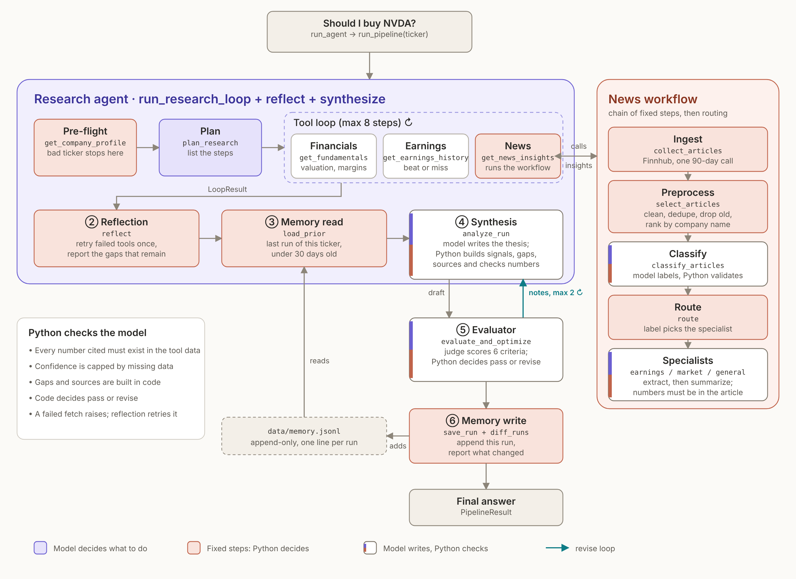

# Multi-Agent Financial Analyst

An autonomous investment research agent for one stock at a time. Given a ticker symbol, it plans its research, calls financial and news tools on its own, checks its own results, and optionally writes an evidence-based analysis that a second model scores and revises. Saved analyses are compared across runs.

The model decides which data to gather and writes the thesis. Python checks every number, computes the signals, decides when to retry, and decides when an analysis is good enough.

> **Educational project, not investment advice.** Built for the AAI-520 final team project (Multi-Agent Financial Analysis System).

- **Repository:** <https://github.com/sudhakaran-srinivasan/multi-agent-financial-analyst>
- **Submitted version:** git tag [`v1.0-group6-submission`](https://github.com/sudhakaran-srinivasan/multi-agent-financial-analyst/tree/v1.0-group6-submission)
- **Architecture:** [docs/ARCHITECTURE.md](docs/ARCHITECTURE.md) (diagrams, naming map, decision log)
- **Final notebook (submission):** [notebooks/Multi_Agent_Financial_Analyst_Final.ipynb](notebooks/Multi_Agent_Financial_Analyst_Final.ipynb) ([PDF](notebooks/Multi_Agent_Financial_Analyst_Final.pdf))

## Team (Group 6)

- Sudhakaran Srinivasan
- April Bradick
- Jeffery Smith

## Architecture at a glance



`run_pipeline` chains six stages. Each stage hands one named data shape to the next, and a crash in a later stage is recorded in `stage_errors` so the run returns what it has.

1. **Research loop** — pre-flight company profile, a research plan, then up to 8 model-driven tool calls.
2. **Reflection** — Python retries each failed tool once and reports the gaps that remain.
3. **Memory read** — the newest saved run of this ticker (under 30 days old).
4. **Synthesis** — the model writes the thesis; Python builds signals, gaps and sources, and verifies evidence numbers.
5. **Evaluator-optimizer** — a judge scores six criteria, Python decides pass or revise, up to two revisions.
6. **Memory write** — the run is appended to history and compared with the previous one.

Stages 5 and 6 are switched on from the command line (`--evaluate`; memory is on unless `--no-memory`). The full diagrams, the file-by-file naming map and the reasons behind each design choice are in [docs/ARCHITECTURE.md](docs/ARCHITECTURE.md). A styled version is in [docs/research-agent-architecture.html](docs/research-agent-architecture.html); download it and open it in a browser.

## Requirements coverage

How each item in the project requirements maps to the code. Every entry point below is a function in `src/finagent/`.

### Agent functions

| Requirement | Implementation | Entry point |
|---|---|---|
| Plans its research steps for a given stock symbol | After a pre-flight company profile, the model lists the tools to call and why, shaped by size, profitability and days to earnings. | `plan_research` in [planner.py](src/finagent/agent/planner.py) |
| Uses tools dynamically (APIs, datasets, retrieval) | The model picks from a tool menu (fundamentals, earnings history, news insights); Python validates and runs each call. Capped at 8 steps. | `run_research_loop`, `dispatch` in [loop.py](src/finagent/agent/loop.py), [dispatcher.py](src/finagent/agent/dispatcher.py) |
| Self-reflects to assess the quality of its output | Python retries failed tools once and reports the data gaps that remain. The evaluator-optimizer also judges the written analysis (see below). | `reflect` in [reflection.py](src/finagent/agent/reflection.py) |
| Learns across runs (brief memories or notes) | Every analysis is appended to an append-only history file. The next run for the same ticker loads the newest record under 30 days old and reports what changed in stance, confidence, signals and data gaps. | `load_prior`, `save_run`, `diff_runs` in [memory.py](src/finagent/memory.py) |

The memory function records and compares runs. The prior record is shown in the report; it is not yet passed into the synthesis prompt, and the model is not trained or fine-tuned by it.

### Workflow patterns

| Requirement | Implementation | Entry point |
|---|---|---|
| Prompt chaining: Ingest → Preprocess → Classify → Extract → Summarize | The `get_news_insights` tool runs a fixed chain: Finnhub ingest, clean/dedupe/rank, model classification, then extract and summarize inside the routed specialist. | `collect_articles`, `classify_articles`, `build_insights` in [workflows/](src/finagent/workflows/) |
| Routing: direct content to the right specialist | The classifier's label (earnings, market, general, irrelevant) selects exactly one of three specialist prompts; irrelevant articles are dropped but kept for audit. | `route` in [news_specialists.py](src/finagent/workflows/news_specialists.py) |
| Evaluator-optimizer: generate → evaluate → refine | The synthesis draft is scored by a judge on six criteria; Python applies the verdict rule; a failing draft goes back through synthesis with the judge's notes, at most twice. | `evaluate_and_optimize` in [evaluator_optimizer.py](src/finagent/workflows/evaluator_optimizer.py) |

### Technology and deliverable requirements

| Requirement | Status |
|---|---|
| Yahoo Finance (`yfinance`) | Used for company profile, price, and fundamentals. |
| Financial news and filings datasets/APIs | Finnhub is used for company news and earnings history. NewsAPI, Alpha Vantage, FRED and SEC EDGAR were considered but not used; see [Data sources](#data-sources). |
| GitHub for version control, with a README | This repository. |
| PEP 8 style | Checked with `ruff`; see [Code style](#code-style). |
| Notebook that includes the GitHub link and explains agent design, functions and evaluation | [notebooks/Multi_Agent_Financial_Analyst_Final.ipynb](notebooks/Multi_Agent_Financial_Analyst_Final.ipynb) includes the GitHub link and design, function and evaluation comments, with live outputs. Submission copies: [PDF](notebooks/Multi_Agent_Financial_Analyst_Final.pdf) and [HTML](notebooks/Multi_Agent_Financial_Analyst_Final.html). |
| AI-tool disclosure | See [AI disclosure](#ai-disclosure). |

## Data sources

| Source | Used for | Key needed | Notes |
|---|---|---|---|
| Yahoo Finance via [`yfinance`](https://pypi.org/project/yfinance/) | Company profile, price, valuation, margins, growth, balance sheet | No | Unofficial scraper, so the version is pinned (`yfinance==1.7.0`). Can change or fail without notice. |
| [Finnhub](https://finnhub.io/) | Company news (one 90-day call per run) and earnings history | `FINNHUB_API_KEY` (free tier) | Free tier allows 60 calls a minute. The free news feed is capped and noisy, so articles are ranked by company mentions. |
| [OpenRouter](https://openrouter.ai/) | Access to the language model (planner, tool loop, news steps, synthesis, judge) | `OPENROUTER_API_KEY` | Pay-per-use; a full run with `--evaluate` makes roughly 10 to 45 model calls. |

Free-tier limits of the alternatives were checked before building: Alpha Vantage allows about 25 calls a day and NewsAPI about 100 a day, which is too tight for a loop that may retry. Earnings beats follow the FactSet convention (actual versus the mean estimate), using one source (Finnhub) and never mixing it with yfinance EPS.

## Tech Stack

- **Language/runtime:** Python 3.11 or newer (the code uses `datetime.UTC`).
- **Model access:** OpenRouter through the `openai` Python client. The default model is `openai/gpt-4o-mini`; the judge uses the same model by default.
- **Agent orchestration:** plain Python functions and workflows. LangChain and LangGraph appear only in a notebook experiment, not in the application.
- **Development tools:** `pytest` and `ruff`, installed with the `dev` extra.

Model names, the API base URL and research-loop limits are in [config.py](src/finagent/config.py).

## Project Structure

```text
multi-agent-financial-analyst/
├── src/finagent/
│   ├── agent/         # Planning, tool loop, reflection, signals, synthesis
│   ├── tools/         # Financial-data and news tools
│   ├── workflows/     # News pipeline and evaluator-optimizer
│   ├── config.py      # Model settings and environment loading
│   ├── contracts.py   # Shared data structures
│   ├── memory.py      # Save analyses and compare runs
│   ├── pipeline.py    # Connect the research stages
│   └── run_agent.py   # Command-line entry point
├── docs/              # Architecture diagrams, naming map and decision log
├── notebooks/         # Demonstration notebook (+ HTML/PDF); sandbox/ holds early experiments
├── tests/             # Offline tests with simulated external responses
├── data/              # Created at run time; memory.jsonl is ignored by Git
├── .env.example       # Variable names only; keep real keys in .env
├── pyproject.toml     # Package metadata and dependencies
├── requirements.txt   # Runtime dependencies (mirrors pyproject.toml)
└── README.md
```

## Setup

You need Python 3.11 or newer and Git. Check with `python3 --version` (macOS/Linux) or `python --version` (Windows).

**1. Get the code.**

```bash
git clone https://github.com/sudhakaran-srinivasan/multi-agent-financial-analyst.git
cd multi-agent-financial-analyst
```

**2. Create an isolated environment and install.**

macOS or Linux:

```bash
python3 -m venv .venv
source .venv/bin/activate
python -m pip install -e ".[dev]"
```

Windows PowerShell:

```powershell
python -m venv .venv
.\.venv\Scripts\Activate.ps1
python -m pip install -e ".[dev]"
```

The editable install (`-e`) makes changes under `src/` available without reinstalling; `[dev]` adds `pytest` and `ruff`. If you prefer a plain requirements file, `python -m pip install -r requirements.txt` installs the runtime packages, but the `finagent` package itself must then be on the path (for example by also running `python -m pip install -e .`).

**3. Add your API keys.** Copy the example file and fill in two values.

```bash
cp .env.example .env            # macOS/Linux
```

```powershell
Copy-Item .env.example .env     # Windows PowerShell
```

```dotenv
OPENROUTER_API_KEY=your_openrouter_key
FINNHUB_API_KEY=your_finnhub_key
```

- OpenRouter key: create an account at <https://openrouter.ai/> and add a small amount of credit (a run costs cents with the default model).
- Finnhub key: register for a free key at <https://finnhub.io/>.
- `OPENAI_API_KEY`, also listed in `.env.example`, is used only by separate notebook experiments. The command-line application does not need it.

Keep `.env` private; it is ignored by Git. Existing environment variables take precedence over `.env`.

Re-activate the environment whenever you open a new terminal. To confirm the interpreter, run `python -c "import sys; print(sys.executable)"`; the path should point inside `.venv`. Run `deactivate` when finished.

## Usage

Run commands from the repository root with the environment activated. Show the available arguments without making any API calls:

```bash
python -m finagent.run_agent --help
```

Collect research data for a stock ticker, then optionally generate an analysis:

```bash
python -m finagent.run_agent NVDA --no-memory
python -m finagent.run_agent NVDA --analyze --no-memory
```

Replace `NVDA` with another company stock ticker, such as `AAPL`. ETFs, indexes and invalid tickers are rejected by the company-profile check before any model call. Both research commands use live APIs and model calls; omitting `--analyze` does not make a run offline.

| Argument | Behavior |
|---|---|
| `ticker` | Required company stock symbol. |
| `--analyze` | Write an analysis after gathering data and running reflection. |
| `--evaluate` | Judge and potentially revise the analysis; use together with `--analyze`. |
| `--no-memory` | Disable reading and writing saved analysis history. |
| `--json` | Print structured JSON instead of the text report. |
| `-h`, `--help` | Display command help and exit. |

The complete system, with the evaluator on:

```bash
python -m finagent.run_agent NVDA --analyze --evaluate
```

Save a structured report to a file:

```bash
python -m finagent.run_agent NVDA --analyze --no-memory --json > nvda-result.json
```

The text report shows the profile, plan, tool trace, collected results, and any analysis or evaluation requested. Check data gaps and stage errors even when the command completes: later-stage failures can leave partial results. `stop: done` means the data loop finished; `step_cap` means it reached the configured limit; `fatal_error` means it stopped on a fatal problem.

Without `--no-memory`, non-fallback analyses are appended to `data/memory.jsonl`, relative to the working directory. The newest record for the same ticker within the 30-day age limit is used for comparison. A saved record does not imply that evaluation passed.

### Example output

Excerpt from a live run of `python -m finagent.run_agent NVDA --analyze --evaluate --no-memory` on 18 Oct 2026 (about one minute). Data and wording vary from run to run.

```text
NVDA  |  stop: done  |  model steps: 4
Profile: NVIDIA Corporation (EQUITY), mega-cap, profitable, earnings in 30 days

Plan:
  1. get_fundamentals: ...understanding key financial ratios will provide insights into valuation, profitability, and growth potential.
  2. get_earnings_history: ...last four quarters of earnings versus analyst estimates...
  3. get_news_insights: ...recent news insights will help gauge market sentiment...

Trace (step 0 = pre-flight check):
   0  get_company_profile    ok
   0  plan_research          ok
   1  get_fundamentals       ok
   2  get_earnings_history   ok
   3  get_news_insights      ok

Results collected:
  get_fundamentals       gaps: 0   warnings: 0
  get_earnings_history   gaps: 0   warnings: 0
  get_news_insights      8 items

News insights (category, sentiment, summary):
  2026-10-18  market   negative Bond investors are showing less confidence in Nvidia, which serves as a warning to Nvidia shareholders.
  2026-10-18  general  positive Honeywell has introduced a new platform called Forge Cognition, which is backed by Nvidia.
  ...

Reflection: Nothing to retry; 0 gaps remain (retrying cannot fix them).

ANALYSIS  |  stance: bullish  |  confidence: medium
...
Scorecard (computed by Python; [+] positive, [=] neutral, [-] negative):
  forward_vs_trailing_pe    13.45  [+]  forward P/E 13.5 is below trailing 27.1: analysts expect earnings to grow
  profit_margin            0.6366  [+]  net profit margin is healthy (10% or more)
  net_cash                  23.6B  [+]  cash exceeds debt (a net cash position)
  earnings_record               1  [=]  beat estimates in 4 of 4 quarters; beating estimates is the norm ...

Evidence:
  - profit margin is healthy = 0.63663  <get_fundamentals.profitability.profitMargins>
  - cash exceeds debt = 23608999936.0  <get_fundamentals.derived.net_cash>

Evaluation: PASSED  |  score 4.00/5  |  revisions: 0  |  the draft passed
  draft       pass   4.00  5 5 3 3 3 5
```

Every evidence line carries the tool-data path it came from, and Python drops any item whose number does not match that path. The thesis text itself is not number-checked: in this run the thesis described revenue growth as 5.9% while the tool data field `revenueGrowth` was 1.059, and the same-model judge still gave numeric accuracy a 5. This is a real limitation; see [Known limits](#known-limits).

## Notebooks

| Notebook | Purpose |
|---|---|
| [Multi_Agent_Financial_Analyst_Final.ipynb](notebooks/Multi_Agent_Financial_Analyst_Final.ipynb) | **Main demonstration notebook**, saved with live outputs. Covers agent design and workflows, the whole pipeline, each module on its own, the failure behaviours, and the evaluator-optimizer loop. Parts 0–2 need API keys; parts of 2 and all of 3 run offline. Use a kernel that has the project installed. Readable exports: [HTML](notebooks/Multi_Agent_Financial_Analyst_Final.html) and [PDF](notebooks/Multi_Agent_Financial_Analyst_Final.pdf). |
| [notebooks/sandbox/](notebooks/sandbox/README.md) | **Not for grading.** Early experiments and scratch work kept for history (API tests, a mock-data evaluator prototype, a Colab news experiment). They may not run as-is. |

To run a notebook locally, register the environment as a kernel (`python -m pip install ipykernel` then `python -m ipykernel install --user --name finagent`), start Jupyter or VS Code, and select the `finagent` kernel. Run cells from the top the first time; the first cell moves to the repository root so `.env` and `data/` are found.

## Testing

Run the automated tests without API keys or live model calls (429 tests):

```bash
python -m pytest -q
```

For a focused check of command-line behavior:

```bash
python -m pytest tests/test_run_agent.py -v
```

Every component that calls out (model, news provider, judge, reviser) is injectable, so the suite runs with no network. Passing tests verify the application's behavior, not live API access or model accuracy.

## Code style

The code follows PEP 8 and is linted with `ruff`:

```bash
python -m ruff check src tests
```

## Evaluation & Iteration

Evaluation checks whether an analysis is supported by the data collected during the run. It is optional: `--analyze` writes an analysis, while adding `--evaluate` enables the evaluator-optimizer loop.

```bash
python -m finagent.run_agent NVDA --analyze --evaluate --no-memory
```

This command requires the OpenRouter and Finnhub keys and makes live calls. `--no-memory` disables reading and writing saved analyses; it does not disable model calls.

An LLM judge compares the draft with the raw tool results and the Python-computed signals. It scores six criteria from **1 (weak) to 5 (strong)** using the anchors in [evaluation_rubric.py](src/finagent/workflows/evaluation_rubric.py):

| Criterion | What is checked |
|---|---|
| Evidence support | Claims are backed by specific collected evidence. |
| Numeric accuracy | Numbers match the tool results, allowing correct rounding. |
| Stance consistency | The stance follows the evidence and acknowledges conflicting signals. |
| Risk coverage | Risks are traceable to the data and important gaps are stated. |
| Confidence calibration | Confidence reflects the strength and completeness of the evidence. |
| Source quality | Sources are named for the evidence used; source authenticity is not verified. |

Python validates the judge's scores and decides the verdict. A draft passes only when its average score is **at least 4.0**, every criterion scores **at least 3**, and the judge reports **no critical issues**. These thresholds are in [evaluation_rules.py](src/finagent/workflows/evaluation_rules.py). A rule decided in code cannot be talked into a pass by the model.

If the draft needs revision, the synthesis model receives the previous draft and the feedback, then rewrites the analysis from the same collected evidence. Each revision goes through the same evidence and confidence checks as the first draft. The loop stops on a pass or after **two revisions** (up to three evaluated drafts). It keeps the best evaluated draft: a passing draft first, then fewer critical issues, then the higher average score; ties keep the earlier draft. A run that never passes is reported as not passed. Judge or revision failures stop the loop and preserve the best available draft; if no judgment succeeded, the run is reported as not evaluated. Rule-based fallback analyses are not evaluated, and fallback revisions are not accepted.

The terminal report shows scores, revision count and the stopping reason. Add `--json` for structured results. The implementation is in [evaluator_optimizer.py](src/finagent/workflows/evaluator_optimizer.py).

Python-side guards that apply on every run, independent of the judge:

- Every evidence item's source path must exist and its number must match within 2%, or the item is dropped.
- Confidence has a Python ceiling set by missing data; the model may ask for less, never more.
- Data gaps and sources are built in code, so the model cannot hide a gap or invent a source.
- In the news workflow, every number in a summary must appear in the article.

The automated tests cover evidence checks, confidence limits, judge-output validation, verdict thresholds, revision limits and failure handling. For development iterations, compare the initial and revised analyses on the same collected data, record scores and critical issues, and manually review whether the revisions address the feedback before changing prompts or thresholds. The demo notebook shows the loop round by round, including a scripted judge that makes the revision behavior visible without API calls.

## Known limits

- The writer and the judge use the same model by default (`JUDGE_MODEL = MODEL` in [config.py](src/finagent/config.py)), which can make the judge lenient on its own writing. Setting a different judge model is the fix.
- The judge has not been calibrated against human ratings and can miss unsupported claims.
- The number check covers evidence items and news summaries; it does not check numbers written in the thesis prose, and it catches invented numbers, not invented non-numeric claims.
- Risks are free text and are not yet source-linked like evidence.
- Finnhub's free news feed is capped and noisy, and news sentiment leans positive because many items are press releases.
- The news step makes many sequential model calls per ticker.
- Memory compares runs but does not yet feed the prior analysis back into the model.
- Rubric scores measure support against the supplied data; they do not establish factual correctness or predict investment performance.

## Troubleshooting

| Symptom | What to check |
|---|---|
| `python` is not recognized | Install Python and open a new terminal. On macOS/Linux use `python3`; on Windows try `py -m venv .venv` if the launcher is available. |
| PowerShell blocks `Activate.ps1` | Run `Set-ExecutionPolicy -Scope Process -ExecutionPolicy Bypass`, then activate again. This applies only to the current terminal session. |
| `No module named finagent` | Activate `.venv`, change to the repository root, and run `python -m pip install -e ".[dev]"`. |
| Import error involving `datetime.UTC`, or pip refuses to install | Use Python 3.11 or newer and recreate the environment with that interpreter. |
| A required key is missing | Check `.env` in the repository root. The CLI needs `OPENROUTER_API_KEY` and the news and earnings tools need `FINNHUB_API_KEY`. |
| Authentication, credit or rate-limit errors | Check the relevant account, key, available credit and usage limits. |
| Missing news or financial fields | Inspect tool errors and data gaps; providers can have incomplete coverage or temporary failures. |

The CLI exit status is `0` for a nonfatal research run, `1` for a fatal research result (bad ticker, not a stock, or a model API failure) and `2` for a caught setup problem such as a missing key. In PowerShell, `$LASTEXITCODE` shows it; in bash or zsh, use `echo $?`. Status `0` does not mean every stage succeeded or the analysis passed evaluation; inspect the report or JSON fields as well.

## AI disclosure

AI (Claude, by Anthropic) was used for brainstorming and iterating on the design, drafting and formatting code and documentation. The team critically reviewed, tested and verified the output end to end.

## License

This project is licensed under the MIT License; see [LICENSE](LICENSE) for details.
