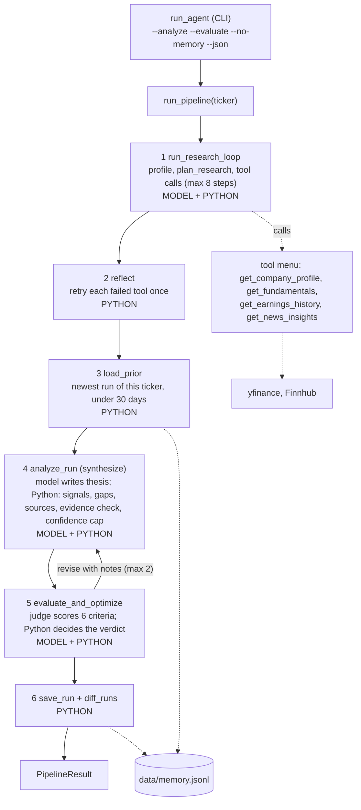
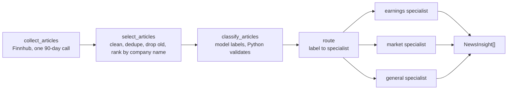
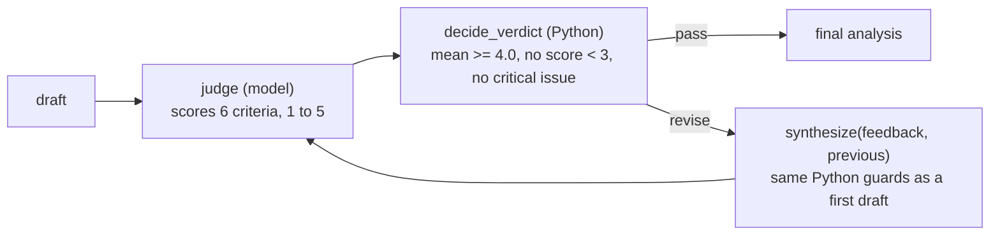

# Research Agent Architecture

An autonomous investment research agent for one stock at a time. The model decides which data to gather and writes the thesis; Python checks every number, computes the signals, decides when to retry, and decides when an analysis is good enough. The names below are the names in the code. Educational project, not investment advice.

A styled version of these diagrams with the decision log is in [research-agent-architecture.html](research-agent-architecture.html); download it and open it in a browser. This file is the copy that GitHub renders. The overview image is also available as [SVG](architecture-overview.svg).

## End-to-end flow

`run_pipeline` chains six stages. A crash in a later stage is recorded in `stage_errors` and the run returns what it has.

## News workflow (prompt chaining and routing)

Each specialist runs Extract (facts) then Summarize (summary and sentiment), two model calls per article. Python checks that every number in a summary appears in the article.

## Evaluator-optimizer loop

At most 2 revisions. A draft that never passes is returned, marked as not passed. The loop also stops if the judge fails after 3 attempts, the reviser crashes, or a revision falls back to the rule-based analysis; the best draft so far is kept.

## Where the course requirements live

| Course requirement | Where it lives | Entry point |
|---|---|---|
| **Agent** | | |
| Planning | decides which tools to call and why, from the company profile | `plan_research` |
| Dynamic tool use | the model calls tools from a menu; Python validates and runs each call | `run_research_loop` + `dispatch` |
| Self-reflection | retries failed tools once and reports the gaps that remain | `reflect` |
| Memory | append-only run history; the next run reports what changed | `load_prior`, `save_run`, `diff_runs` |
| **Workflow patterns** | | |
| Prompt chaining | news: Ingest, Preprocess, Classify, Extract, Summarize | `get_news_insights` |
| Routing | the classifier's label selects one of three specialists | `route` |
| Evaluator-optimizer | judge scores, Python decides, synthesis revises, at most 2 rounds | `evaluate_and_optimize` |

## Naming map

| Concept | File | Entry point | Who decides |
|---|---|---|---|
| Command line | `run_agent.py` | `main → run_pipeline` | PYTHON |
| Pipeline conductor | `pipeline.py` | `run_pipeline` | PYTHON |
| Pre-flight check | `tools/company_profile.py` | `get_company_profile` | PYTHON |
| Planner | `agent/planner.py` | `plan_research` | MODEL |
| Research loop (the agent core) | `agent/loop.py` | `run_research_loop` | MODEL + PYTHON |
| Tool dispatcher | `agent/dispatcher.py` | `dispatch` | PYTHON |
| Tool menu | `tools/tool_specs.py` | `TOOL_SPECS, TOOL_FUNCTIONS` | PYTHON |
| Fundamentals tool | `tools/fundamentals.py` | `get_fundamentals` | PYTHON |
| Earnings tool | `tools/earnings_history.py` | `get_earnings_history` | PYTHON |
| News tool | `tools/news.py` | `get_news_insights` | MODEL + PYTHON |
| Reflection | `agent/reflection.py` | `reflect` | PYTHON |
| Signals | `agent/signals.py` | `compute_signals` | PYTHON |
| Synthesis | `agent/synthesis.py` | `analyze_run / synthesize` | MODEL + PYTHON |
| Memory | `memory.py` | `load_prior, save_run, diff_runs` | PYTHON |
| News: ingest and preprocess | `workflows/news_ingest.py` | `collect_articles` | PYTHON |
| News: classify | `workflows/news_classify.py` | `classify_articles` | MODEL + PYTHON |
| News: route, extract, summarize | `workflows/news_specialists.py` | `route, build_insights` | MODEL + PYTHON |
| Evaluation rubric | `workflows/evaluation_rubric.py` | `RUBRIC, build_rubric_text` | PYTHON |
| Verdict rules | `workflows/evaluation_rules.py` | `decide_verdict` | PYTHON |
| Evaluator-optimizer | `workflows/evaluator_optimizer.py` | `evaluate_and_optimize, evaluate_run` | MODEL + PYTHON |
| Data shapes | `contracts.py` | `LoopResult, Analysis, NewsInsight, Evaluation` | — |
| Settings | `config.py` | `MODEL, JUDGE_MODEL, MAX_STEPS` | — |

## Decision log

The choices a reader will ask about, with the reason and the place in the code. Thresholds are named constants marked `# AUTHOR:` in the source.

| Decision | Why | In the code |
|---|---|---|
| **Agent design** | | |
| The model chooses tools; code owns everything checkable | A model can omit a gap, round a number into a different one, or sound more certain than the data allows. The model proposes, Python checks. | `planner.py` `loop.py` (model); `reflection.py` `evaluation_rules.py` (code) |
| Pre-flight profile before planning | A bad ticker or an ETF stops the run before any model call is spent. The profile (size, profitability, days to earnings) also shapes the plan. | `get_company_profile`, stop_reason fatal_error |
| Step cap of 8 | Stops a looping model and leaves room for retries; it is a safety stop, not a cost saving. | `config.MAX_STEPS` |
| Reflection is code, not a model | A retry helps transient failures only. A permanent gap (negative earnings) must not be retried. | `reflect`, `MAX_RETRIES_PER_TOOL = 1` |
| A failed fetch raises; an empty result does not | A quiet empty list would make the trace say success with no data. The dispatcher is the one place that catches the error and records ok=False, so reflection can retry. | `dispatch`; `get_earnings_history`, `get_news_insights` |
| Pipeline failure policy | A setup error (missing API key) raises. A fatal data error is a normal result. A crash in a later stage is recorded and the run returns what it has. | `PipelineResult.stage_errors` |
| **Analysis** | | |
| Signals are computed by Python | Each is a small checkable judgment with its source field; the model must account for every one. Thresholds are named constants marked AUTHOR. The scorecard is output only, with no invented letter grades. | `compute_signals`, `format_scorecard` |
| Confidence has a Python ceiling | Missing fundamentals or earnings history: low. Three or more genuine core gaps, or fewer than 3 quarters: medium. The model may ask for less, never more. | `confidence_ceiling`, `apply_ceiling` |
| Evidence must be verifiable | Each item's source path must exist and its number must match within 2%, or the item is dropped. No verifiable evidence means a rule-based fallback at low confidence. | `check_evidence` |
| Gaps and sources are built by Python | The model cannot hide a gap or invent a source. | `build_data_gaps`, `build_sources` |
| Earnings beats follow the FactSet convention | Actual vs the mean estimate, rounded to cents half-up. Percent surprise is left out when the estimate is under $0.10. A beat is the baseline (about 78% of S&P 500 companies). One source (Finnhub) is never mixed with yfinance EPS. | `earnings_history.py` |
| **News workflow** | | |
| One 90-day call, a 14-day window, widened once | The free tier allows 60 calls a minute. The window is chosen locally; if fewer than 3 articles remain it widens once and the result says so. | `LOOKBACK_DAYS`, `WIDE_LOOKBACK_DAYS`, `MIN_ARTICLES` |
| Rank by company mentions before the cap, never filter by it | Finnhub returns about 250 newest items and tags roundups with the ticker. A pool of 20 is classified until 8 relevant ones are found. | `rank_candidates`, `MAX_CANDIDATES`, `MAX_ARTICLES` |
| A bad label is skipped, never guessed | Irrelevant articles are dropped but kept for audit. Article text goes only in the user message, never the system prompt, so it cannot give the model orders. | `classify_articles`, `parse_label` |
| Summaries are grounded | Every number in the facts and the summary must appear in the article. The summary is written from the extracted facts only and is length-capped. | `check_numbers_grounded` |
| Stale news is a data gap | Newest article older than 14 days is reported, so confidence can be judged. | `build_data_gaps` |
| **Memory** | | |
| Append-only, filtered on read | Everything is kept; only the newest record under 30 days is used. Deleting is irreversible, hiding is not. Python computes the diff. Fallback analyses are not saved. On in the CLI, off in the library. | `memory.py`, `MAX_AGE_DAYS = 30` |
| **Evaluator-optimizer** | | |
| The judge scores; Python decides | Pass needs mean ≥ 4.0, no score below 3, and no critical issue. The rule is deterministic and testable; a model deciding could be talked into a pass. | `decide_verdict` |
| Six criteria with 1 / 3 / 5 anchors | Combined from two team members' draft rubrics. Dropped actionability (the contract always forces a stance) and thesis_quality (overlaps evidence and consistency); added numeric_accuracy and confidence_calibration, which need the raw tool data. | `evaluation_rubric.py` |
| The reviser is synthesis itself | A revision passes the same Python guards as a first draft, so it cannot invent evidence to raise its score. The best draft is kept, and a draft that never passes is marked, never passed silently. | `evaluate_and_optimize`, `synthesize(feedback, previous)` |
| The judge model is its own setting | The same model writes and judges by default, which can be lenient. Changing config.JUDGE_MODEL is the fix. | `config.JUDGE_MODEL` |
| **Engineering** | | |
| Everything that calls out is injectable | runner, reflector, analyst, evaluator, classifier, analyzer, judge and reviser are parameters, so the whole suite (427 tests) runs with no model and no network. | the `= default` arguments in each signature |
| Free-tier limits checked before building | Finnhub 60 calls a minute, Alpha Vantage 25 a day, NewsAPI about 100 a day; yfinance is unofficial. | — |

## Data shapes between stages

Each stage hands one named shape to the next (defined in `contracts.py`).

| Shape | Produced by | Holds |
|---|---|---|
| `LoopResult` | `run_research_loop`, `reflect` | ticker, stop_reason, profile, plan, results, trace, fatal_error |
| `Reflection` | `reflect` | tools retried, gaps that remain, a summary |
| `NewsInsight` | `get_news_insights` | category, summary, sentiment, source_url, published |
| `Analysis` | `analyze_run` | ticker, stance (bullish / neutral / bearish), confidence (low / medium / high), thesis, evidence_used, risks, sources, data_gaps |
| `Evaluation` | `to_evaluation` | verdict, overall_score, scores, feedback, rounds_used, final_analysis |
| `RunRecord` | `record_from_outcome` | ticker, saved_at, stance, confidence, thesis, signals, data_gaps |
| `PipelineResult` | `run_pipeline` | all of the above plus stage_errors, prior, changes, saved |

## Failure policy

- Setup problem (missing API key): raises.
- Bad ticker or not a stock: a normal result, later stages skipped.
- Failed fetch: raises, so the trace shows ok=False and reflection can retry.
- Later-stage crash: recorded in stage_errors; the run returns partial results.
- Unusable model reply in synthesis: rule-based analysis at low confidence.

## Known limits

- The same model writes and judges by default (`config.JUDGE_MODEL`).
- The judge is not yet calibrated against human ratings.
- The number check catches invented numbers, not invented claims.
- Risks are free text; they are not yet source-linked like evidence.
- Finnhub's free news feed is capped and noisy; news sentiment leans positive.
- The news step makes many sequential model calls per ticker.

## Next

- Give the model the prior run as context (today the diff only appears in the report).
- Scorecard formatting: percentages and the earnings-record label.
- Compare the LLM news classifier with a simpler baseline on about 20 hand-labeled headlines.
- A CI check that runs the offline tests and the linter on every push.
